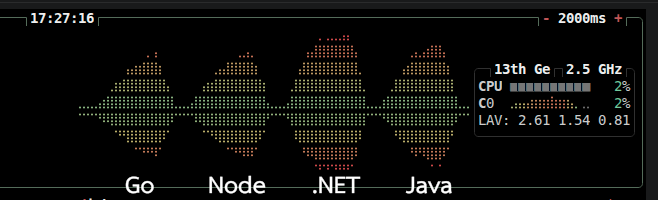

# Cluster Demo
เรียนรู้ Thread และ คลัสเตอร์ เบื้องต้น แบบไม่ซับซ้อนบน VM หนึ่งตัว จะใช้ K6 ในการทดสอบ

[](https://youtu.be/p_vJI8P5z8c "Cluster demo")

ใช้เป็นแนวทางในการทำคลัสเตอร์บนหลาย VM และ K8s ในตอนต่อๆไป

## 1 VM
เหมาะสำหรับ Node.js เพื่อให้ใช้ได้ทุก CPU core
- **Runtime:** Node.js 
- **Framework:** Express.js
- **Process Manager:** PM2 (Cluster Mode)
- **Docker Container:** Cluster แบบ Microservice
- **Reverse Proxy & Load Balancer:** Traefik v3
- **Load Testing Tool:** Grafana k6
- เทียบกับ Framework อื่นๆที่ใช้งานได้ทุก core โดยไม่จำเป็นต้องทำ Cluster .NET(C#), Go, Java

---

### Architecture Overview
Cluster แบบง่ายด้วย PM2
```text
               [ Traffic / Requests ]
                         │
                         ▼
             [ PM2 Cluster Mode ] (Port 3000)
                         │
        ┌────────────────┴────────────────┐
        ▼                                 ▼
 [ node-app-1 ]                   [ node-app-1 ]
```
Cluster โดยใช้ Docker จะใช้ Traefik เป็น loadbalancer และ API Gateway

```text
               [ Traffic / Requests ]
                         │
                         ▼
             [ Traefik Load Balancer ] (Port 80)
                         │
        ┌────────────────┴────────────────┐
        ▼                                 ▼
 [  Container 1 ]                 [ Container 2 ]
```

---

## 📂 Structure
```
express-bun-traefik-k6/
├── dotnet/                 <-- .NET Web API
│   ├── dotnet-app.csproj   
│   ├── Program.cs
│   └── Dockerfile
├── go/                     <-- GO Web API
│   ├── main.go
│   └── Dockerfile
├── java/                   <-- Java Web API
│   ├── pom.xml
│   ├── src/
│   │   └── main/
│   │       ├── java/com/example/demo/
│   │       │   ├── DemoApplication.java
│   │       │   └── AppController.java
│   │       └── resources/
│   │           └── application.properties
│   └── Dockerfile
├── node/                   <-- Express.js Web API
│   ├── src/app.js
│   ├── ecosystem.config.js <--  PM2 Cluster Configuration
│   ├── package.json
│   └── Dockerfile
├── k6/                     <-- K6 Load test tools
│   ├── io-test.js            <-- Simulates I/O Intensive Task
│   └── load-test.js          <-- Simulates CPU Intensive Task
├── docker-compose.yml      <-- node, go, .NET, java, k6
└── README.md
```
---
## install
- สร้าง VM Linux(Debian) 8GB, 6Core(Optional: แบบ hotplug จะได้ปรับ vcore โดยไม่ต้อง Restart )
- ติดตั้ง btop, [docker](https://docs.docker.com/engine/install/debian/), 
[nvm](https://github.com/nvm-sh/nvm), 
[pm2](https://pm2.io/docs/runtime/guide/installation/),
[k6](https://grafana.com/docs/k6/latest/set-up/install-k6/)
```sh
## install btop docker
sudo apt install btop
curl -fsSL https://get.docker.com -o get-docker.sh
sudo sh get-docker.sh
sudo usermod -aG docker $USER
## install nvm
curl -o- https://raw.githubusercontent.com/nvm-sh/nvm/v0.40.6/install.sh | bash
nvm install --lts
## install pm2
npm install pm2 -g
```
- ติดตั้ง [k6](https://grafana.com/docs/k6/latest/set-up/install-k6/) ไว้อีกเครื่อง

```
sudo apt install gpg
curl -fsSL https://dl.k6.io/key.gpg | sudo gpg --dearmor -o /usr/share/keyrings/k6-archive-keyring.gpg
echo "deb [signed-by=/usr/share/keyrings/k6-archive-keyring.gpg] https://dl.k6.io/deb stable main" | sudo tee /etc/apt/sources.list.d/k6.list
sudo apt-get update
sudo apt-get install k6
```
---
## ทดสอบระบบ

### ทดสอบ Express.js เบื้องต้น

```sh
cd node
npm i 
npm start # development on port 3000
curl http://localhost:3000/node/health
curl http://localhost:3000/node/api/fast
curl http://localhost:3000/node/api/work
```
### ทดสอบ Express.js PM2 Cluster
รันที่พอร์ต 3000 แนะนำให้ลองเริ่มจาก 1 instances จนถึง

```sh
# รัน Cluster เลือก ในสองแบบบนี้
pm2 start ecosystem.config.js
pm2 start src/app.js --name my-api --instances 2
# Monitor
pm2 list
pm2 monit
btop
# หยุดการทำงานและนำออกจากรายการ
bm2 stop my-api
pm2 delete all
# Bench mark ด้วย k6 จากอีกเครื่อง 

curl http://192.168.2.37:3000/node/api/work?iterations=50000000
TARGET_URL=http://192.168.2.37:3000/node k6 run k6/load-test.js
docker compose up -d traefik app-node --build


```
### ทดสอบ docker Cluster Express.js + traefik
- Web Application จะให้บริการที่: `http://localhost`
- Traefik Dashboard จะให้บริการที่: `http://localhost:8080`

```bash
docker compose up -d traefik app-node --build --scale app-node=1

docker compose up -d traefik app-node --scale app-node=2
# Traefik Dashboard (http://localhost:8080) จะเห็น HTTP Services มี app-node 2 Servers
TARGET_URL=http://192.168.2.37/node k6 run k6/load-test.js
# รันบน VM เพื่อการทดสอบ
docker compose run --rm -e TARGET_URL=http://traefik/node k6 run /scripts/load-test.js 
# ตัวอย่างยิงโหลดหนักๆ ไปที่ CPU-bound calculation (`/api/work`) เพื่อทดสอบขีดจำกัดของ CPU:
docker compose run --rm -e TARGET_URL=http://traefik/node k6 run --vus 100 --duration 30s /scripts/load-test.js
```

### เปรียบเทียบกับ .NET, Go, Java 
.NET, Go, Java ทำงานแบบ multi-thread ทำให้ใช้ได้ทุก core โดยไม่ต้องทำ cluster บน VM(เดียว)

```bash
docker compose up -d --scale app-node=6
# .NET
TARGET_URL=http://192.168.2.37/dotnet k6 run k6/load-test.js
# Go
TARGET_URL=http://192.168.2.37/go k6 run k6/load-test.js
# Java
TARGET_URL=http://192.168.2.37/java k6 run k6/load-test.js

# ตัวอย่างยิงโหลดหนักๆ ไปที่ CPU-bound calculation (`/api/work`) เพื่อทดสอบขีดจำกัดของ CPU:
TARGET_URL=http://192.168.2.37/go k6 run --vus 100 --duration 30s k6/load-test.js

# ยิง Request ต่อเนื่องเพื่อดูว่า Traefik กระจายงานไปยัง Container / Worker ของ Express.js ตัวไหนบ้าง:
for i in {1..15}; do curl -s http://localhost/node/api/fast | grep hostname; done


TARGET_URL=http://192.168.2.37/node k6 run k6/io-test.js

```
## Multi-Thread
- ระบบปฎิบัติการปัจจุบันเป็นระบบ Multi-Task(Process) หลายโปรแกรมทำงานอยู่ โดยการสลับกันทำงานอย่างรวดเร็ว จนเหมือนทำงานพร้อมๆกัน ตามเวลา
- โปรแกรมจะทำงานได้หลาย Thread จะเป็นหน่วยเล็กกว่า Task ใช้ทรัพยากรน้อยกว่า
- OS Thread เรียกได้อีกอย่างว่า Platform Thread
- การสร้าง Thread จะมี Over head (≈ 1 MB/Thread)อยู่บ้างดังนั้นจะสร้างไว้ล่วงหน้าแล้วเก็บไว้ใช้ต่อใน Thread Pool 
- Thread เดียวก็สามารถทำงานได้ใช้ทรัพยากรน้อย โดยใช้ None Block IO คือถ้า IO ยังไม่พร้อมที่จะรับส่งข้อมูลก็จะข้ามไปทำงานอื่นได้ แต่ถ้าต้องทำงานที่ใช้ CPU ก็ต้องทำให้เสร็จก่อนก็จะทำให้มีการล่าช้าตรงจุดนี้
- Java Virtual Threads (JVM) ซึ่งเปิดตัวใน Java 21 เป็นเธรดขนาดเล็กที่จัดการโดย JVM แยกออกจากเธรดของระบบปฏิบัติการ เหมาะอย่างยิ่งสำหรับงานที่เน้นการรับส่งข้อมูล (I/O-bound tasks) ช่วยลดความซับซ้อนของโค้ดโเขียนโค้ดแบบบล็อก (Blocking Style) ตามลำดับขั้นตอนปกติ แต่รันเบื้องหลังด้วยประสิทธิภาพสูงโดยไม่ต้องใช้ syntax async/await 
- ในวีดีโอจะใช้ Java Threads แบบดั้งเดิม comment ใต้ Video ใน Youtube มีคนแนะนำให้ลองใช้ Virtual Threads ผมพึ่งเคยลองใช้มันง่ายมากเลย เพิ่มบรรทัดด้านล่างในไฟล์นี้ java/src/main/resources/application.properties ทดสอบแบบเดิม ทำให้ Java กับงาน I/O ใช้ CPU น้อยลงชัดเจนดังภาพ

```
spring.threads.virtual.enabled=true
```


- .NET (C#) ไม่มีฟีเจอร์ "Virtual Threads" เมื่อเจอคำสั่งรอ I/O เธรดของระบบปฏิบัติการ (OS Thread) จะถูกปล่อยให้ไปทำงานอื่น (Non-blocking) ผู้พัฒนาต้องเขียนโค้ดกำกับด้วย async และ await ทำให้เมธอดถูกแบ่งออกเป็นประเภท Asynchronous 
- ภาษา Go ใช้ Goroutine ซึ่งมีแนวคิดและการทำงานแบบเดียวกันกับ Virtual Threads อยู่ในภาษา go ตั้งแต่ต้นโค้ดตัวอย่างจึงรองรับโดยตรง


---

## ตัวอย่างการผลลัพธ์
1. **Response Time (p95):** เปรียบเทียบระยะเวลาตอบสนองระหว่าง 1 Container vs 4 Containers เมื่อเจอ Concurrency สูงๆ
2. **CPU Utilization:** ตรวจสอบการกระจายภาระงานผ่าน PM2 `cluster` mode + Traefik Round-robin ใช้ btop
3. **HTTP Success Rate:** ตรวจสอบว่ามี Request ที่หลุด หรือเป็น 5xx / Timeout หรือไม่ขณะทำ High Concurrency Test
